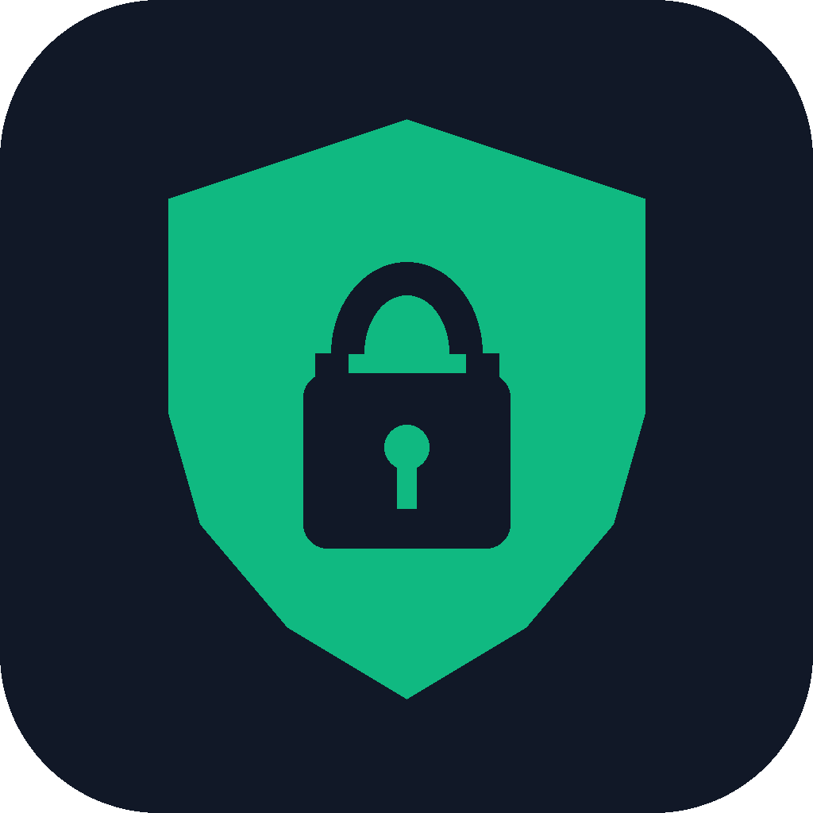

<p align="center"></p>

# Secure My Server

A **Claude Code plugin** that finds and fixes security problems on Linux servers, **safely**, and proves the fixes work.

Right now its main job is the **October 2026 "PHP2Shell" vulnerabilities** in PHP (CVE-2026-109618 and CVE-2026-109619): unauthenticated remote code execution, actively exploited. Every server is set up differently, so the plugin **detects how each server is built first**, then follows the right steps for that setup.

> **Use it only on servers you own or are allowed to administer.** It asks before every change, but you are the one who says yes.

---

## What you get

| | Name | What it does |
|---|---|---|
| Skill | **`php2shell-response`** | Finds **every** PHP on one or many servers, decides honestly whether each is patched (distro backports included), looks for signs the hole was already used, patches or mitigates per setup, and proves it. |
| Skill | **`secure-my-server`** | The full pass: inventory, break-in check, open database ports, PHP and web-server hardening, secret rotation, deploy safety, independent re-check, simple reports. |
| Agent | **`server-verifier`** | A second Claude that re-checks everything, read-only. It is given the problems, never the fixer's conclusions. |
| Scripts | `scripts/` | Read-only detectors you can also run **without Claude**. They never print secrets or file contents. |
| Guides | `guides/` | What to do on each setup: Docker, Debian/Ubuntu, RHEL family, Alpine, cPanel, Plesk, aaPanel, DirectAdmin, CyberPanel/OpenLiteSpeed, FrankenPHP, hand-built PHP; nginx, Apache, Caddy, LiteSpeed, CDN/WAF; ufw, firewalld, nftables/iptables, Docker networking. |

---

## Install

You need [Claude Code](https://code.claude.com), SSH access to your servers, and ideally `sudo` without a password there (`sudo -n true`).

In Claude Code:
```
/plugin marketplace add ankitraj20616/secure-my-server
/plugin install secure-my-server@secure-my-server
```
Or from a terminal:
```bash
claude plugin marketplace add ankitraj20616/secure-my-server
claude plugin install secure-my-server@secure-my-server --scope user
```
`--scope user` makes it available in **every** project, not just one.

**Updates:** third-party plugins do not update on their own by default. Run `claude plugin update secure-my-server@secure-my-server`, or turn on auto-update in `/plugin` → Marketplaces.

---

## Use

Just ask. For example:

> "Check my servers `web1`, `web2` and `shop` for PHP2Shell and patch them. `shop` is production."

> "Is the PHP on `ssh myvps` safe from CVE-2026-109618?"

> "Audit and harden `ssh myvps`. It runs WordPress on cPanel and a Node app in Docker."

Or call a skill directly: `/secure-my-server:php2shell-response web1 web2`.

What happens, for PHP2Shell:
1. **Claude asks once:** which servers, which are production, what is hands-off.
2. **Detect (read-only):** every PHP runtime on every server, with its kind, version and patch status.
3. **Check for an attack (read-only):** suspicious requests, crashed PHP workers, planted files, new users, keys, cron jobs and connections. Evidence is saved before anything changes.
4. **Mitigate**, if a patch cannot happen today.
5. **Patch**, the right way for that setup: staging first, production only after you say yes.
6. **Prove it:** the running PHP is the fixed one, the sites still work, and an independent agent agrees.
7. **Report:** one table for all your servers, plus what is still open.

---

## The scripts on their own

Every detector is one self-contained bash file. Run it on a server over SSH; nothing is installed or changed:
```bash
ssh myvps 'sudo -n bash -s' < scripts/php_runtimes.sh
ssh myvps 'sudo -n bash -s -- --since 2026-10-15' < scripts/php2shell_ioc_scan.sh
```
| Script | Tells you |
|---|---|
| `detect_stack.sh` | OS, control panel, the web server that really serves :80/:443, firewall, Docker, public listeners |
| `php_runtimes.sh` | every PHP (host, panel, Docker), its SAPI, version, **patch status**, and key settings |
| `php2shell_ioc_scan.sh` | exploit-shaped requests and PHP worker crashes in the logs |
| `webshell_scan.sh` | new or planted PHP files, PHP hidden in upload folders and images |
| `persistence_check.sh` | new users, SSH keys, cron, services, odd processes and outbound connections |

Output is one finding per line: `LEVEL<TAB>CHECK<TAB>DETAIL`, with LEVEL one of `CRIT`, `WARN`, `INFO`, `OK`, `SKIP`. Each script has `--help`.

**What "patched" means here:** for builds that follow php.net's numbers (Docker official images, Ondřej Surý, Remi, the panels), the version must be at least **8.5.12, 8.4.27, 8.3.36 or 8.2.35**. Distro packages (Ubuntu, Debian, RHEL family) keep their old version number, so the script reads the **package changelog** for the CVE instead. 8.1 and older get no official fix.

---

## Safety model

- **Read-only first.** Nothing changes until the setup is known and the evidence is saved.
- **Asks before:** any production restart or deploy, deleting anything, firewall or SSH changes, and touching projects you marked hands-off.
- **Never prints a secret.** Values are compared by fingerprint, never shown.
- **Honest about limits.** "No signs found" is never reported as "not attacked".
- **Independent check.** A separate agent verifies, without seeing the fixer's conclusions.

---

## Repository layout
```
.claude-plugin/   plugin.json, marketplace.json, icon
skills/
  php2shell-response/   SKILL.md + references/ (advisory, compromise response, fleet, verify)
  secure-my-server/     SKILL.md + references/ (9 phases, 30 traps, worked example)
agents/           server-verifier.md
scripts/          read-only detectors + rotation helpers
guides/           php/, web/, firewall/  (one file per setup)
templates/        php, nginx, caddy, firewall, compose
tests/            bats tests with fake servers (fixtures)
tools/            repository checks
docs/             plain-English guides for people
```

---

## Status

**v0.2.0.** The steps come from a real incident and were used on a real server. The detectors are tested against fake servers for each supported setup, not yet against many real ones. Please report what breaks: [issues](https://github.com/ankitraj20616/secure-my-server/issues). Security problems in the plugin itself: see [`SECURITY.md`](SECURITY.md).

The advisory facts are dated **27 October 2026**. Always check [php.net](https://www.php.net/archive/2026.php) for newer advisories.

## Contributing

New server setups, guides and traps are very welcome. See [`CONTRIBUTING.md`](CONTRIBUTING.md).

## License

[MIT](LICENSE). No warranty: you are responsible for the servers you run it on.
